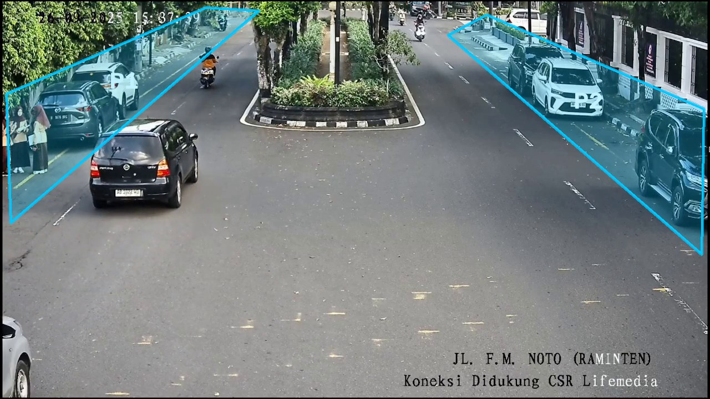

# Illegal Parking Detection

Detects vehicles that stay parked in no-parking zones on a street CCTV feed. YOLOv8 detects vehicles,
ByteTrack keeps a stable ID for each one, and a vehicle whose centre stays inside a marked parking area
for 30 seconds is flagged as **PARKED**. Five YOLOv8 sizes are benchmarked on the same footage to find
the best speed/accuracy trade-off for real-time use.



## Pipeline

| # | Notebook | What it does |
|---|---|---|
| 1 | `code/cut-raw-video.ipynb` | Cuts a test clip out of the raw CCTV recording (MoviePy, H.264). |
| 2 | `code/define-park-areas.ipynb` | Click 4 points per area on a frame (OpenCV) → saved to `output/parking-areas-*.json`. |
| 3 | `code/parking-detection.ipynb` | Per frame: YOLOv8 detection → ByteTrack IDs → centre-in-polygon test → 30 s timer → PARKED. Logs tracking gaps. |
| 4 | `code/model-comparison.ipynb` | Runs step 3 for YOLOv8 n / s / m / l / x on the same clip and scores them. |
| 5 | `code/evaluation.ipynb` | Loads experiment and comparison results for analysis, charts and export. |

Key settings: confidence ≥ 0.5; classes car, motorcycle, bus, truck (COCO 2, 3, 5, 7);
`model.track(persist=True)` (ByteTrack); `cv2.pointPolygonTest` on the box centre; `parking_threshold = 30` s.

## Results

Test clip: 10 minutes, 18,000 frames at 30 FPS, 2 parking areas
(`output/comparisons/.../model_comparison.csv`).

| Model | Avg FPS | Tracking quality | Overall score | Parked vehicles flagged |
|---|---:|---:|---:|---:|
| **YOLOv8n** | **19.5** | 95.05 | **87.49** | 20 |
| YOLOv8s | 11.6 | 96.76 | 80.33 | 16 |
| YOLOv8m | 6.3 | 97.96 | 75.48 | 22 |
| YOLOv8l | 3.7 | 98.38 | 73.06 | 18 |
| YOLOv8x | 2.8 | 98.38 | 72.17 | 19 |

- Tracking quality = 100 − (tracking gaps / detections × 100).
- Overall = 0.3 × FPS score (FPS / 30) + 0.4 × tracking quality + 0.3 × detection score.
- YOLOv8n is the only model near real time and has the best overall score; larger models track a little
  more steadily but run up to ~7× slower.

## Run locally

```bash
python -m venv .venv
.venv\Scripts\activate          # Windows (macOS/Linux: source .venv/bin/activate)
pip install -r requirements.txt
jupyter lab                     # then run the notebooks in code/ in the order above
```

The CCTV videos (`dataset/`) and YOLO weights (`yolo-model/`) are not in the repository. Put your own
video in `dataset/`; Ultralytics downloads the `yolov8*.pt` weights on first use.

## Outputs

Each run writes to `output/experiments/<model>_<video>_<timestamp>/`: `results.json`, `summary.csv`,
`parked_vehicles.csv` and `tracking_issues.csv`.
